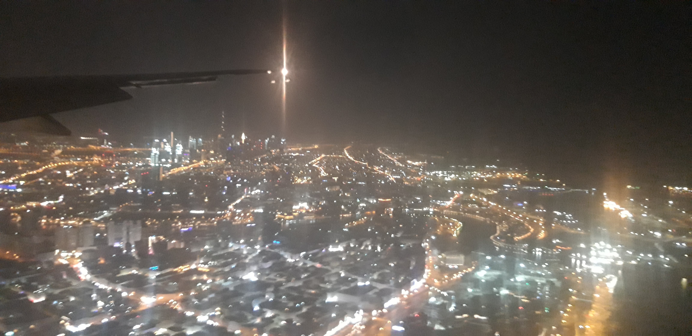
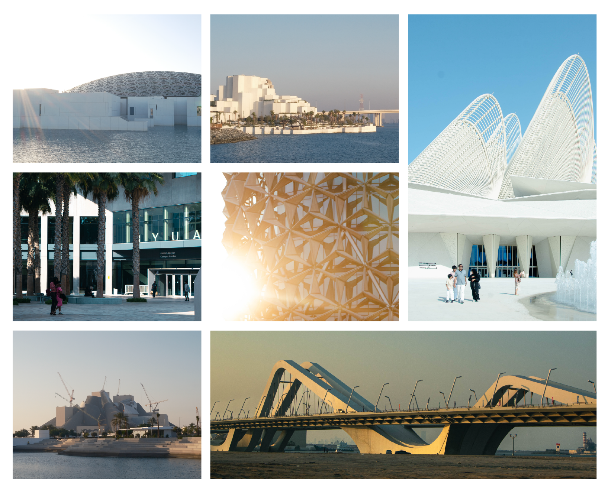
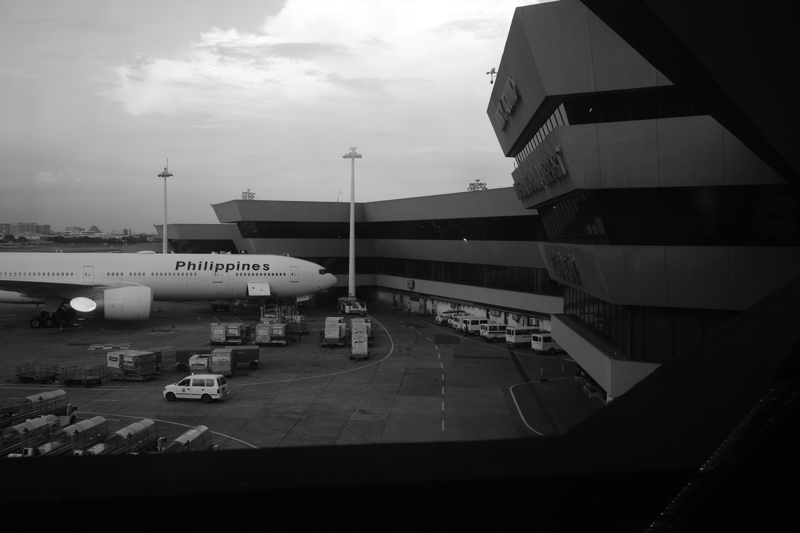

*The following essay was adapted from a presentation that I had pitched for Anthology Asean 2026. Though I wasn't able to present it in person, I still felt that it was worth sharing.*

 

### Prologue
*Mawaa (noun): home, shelter, sense of place.*

Hello dear reader, and thank you for reading this essay. I'm writing about something very personal, something I'm very passionate about. Not just about architecture, but my experiences between the UAE and the Philippines. My journey in search of مأوى (Mawaa). In Arabic, it means home, shelter, belonging, and it encapsulates this internal struggle that I've been grappling with between the two places I call home.

It's a story through the lens of my personal journey in architecture, and a bit of Arabic vocabulary.

That journey can be traced to 9 years ago. Anthology 2017. I was still in high school, but I already knew I wanted to be an architect. I grew up seeing the work of other architects and engineers around me in Manila, the place I called home for most of my life. In the mundane moments stuck in traffic, with nothing else to do I couldn’t help but look up. I would look up at the flyovers that criss-crossed above the gridlocked streets they tried to decongest. I’d look up at the skyscrapers of BGC towering above the derelict houses beside them. I would look up and just daydream. I would think about why things in Manila were the way they were, and try to figure out how the not so well-oiled machine worked.

I’ve come to understand that the built environment has such a profound impact on our daily lives. For better or for worse, these are the spaces that we see, inhabit, work in, and experience. They can influence us in subtle ways. And I wanted to harness it to better peoples' lives. To learn how we react and live through spaces. At the time, I was just an attendee. Just as enthralled by the speakers and their projects and their panels. I was going around asking for photos and autographs.

When the time came that I had to make a decision for university, I was faced with two options: architecture at the University of Santo Tomas, arguably one of the best (and certainly one of the most competitive) architecture programs in the Philippines, or go to NYU Abu Dhabi, which doesn't have an architecture program. I chose the latter (more on the implications of that later), and I didn't expect what I had in store for me since that choice was made.

<h3 id="beyond-the-burj" class="has-ar">
  Beyond the
  برجBurj
</h3>

*Burj (noun): tower*

 

The photo above is one I took when I first arrived in the UAE back in 2020. Despite the pretty bad quality, you can almost see the Burj Khalifa in the distance. Everyone knows about the Burj Khalifa. It's one of the buildings that put the country on the map. Whenever I visit Dubai and spot it in view, I can't help but look up in awe. In a way, it encapsulates the zeitgeist of architecture in the UAE: the sky is the literal limit.

 

But there's more to the UAE than just the Burj. Abu Dhabi, the city I've called home for six years now, is an architect's playground. My university was designed by the late Rafael Viñoly, and its architecture has undoubtedly shaped my formative experiences. There's also the Cultural District. Jean Nouvel, Norman Foster, Frank Gehry (almost once, soon twice). Zaha Hadid has the Sheikh Zayed Bridge. Where else can you find the same concentration of great structures in one city?

  
  
  

    

      <svg xmlns="http://www.w3.org/2000/svg" viewBox="0 0 512 512" style="width: 20px; height: 20px;"><path d="M406.6 374.6l96-96c12.5-12.5 12.5-32.8 0-45.3l-96-96c-12.5-12.5-32.8-12.5-45.3 0s-12.5 32.8 0 45.3L402.7 224l-293.5 0 41.4-41.4c12.5-12.5 12.5-32.8 0-45.3s-32.8-12.5-45.3 0l-96 96c-12.5 12.5-12.5 32.8 0 45.3l96 96c12.5 12.5 32.8 12.5 45.3 0s12.5-32.8 0-45.3L109.3 288l293.5 0-41.4 41.4c-12.5 12.5-12.5 32.8 0 45.3s32.8 12.5 45.3 0z"/></svg>
    

  

   

  
2021

  
2025

<small> Satellite imagery of Saadiyat Island from Google Earth. <small>

 

And it was also half as empty when I arrived. The breakneck speed of construction was a culture shock. Things just happen quickly, at least compared to in the Philippines. Seeing change happen before your eyes is one thing. Experiencing the places you've lived and interacted with transform into new spaces is another.

To me, having all these architectural sites and seeing all this change has highlighted the importance of experiencing. We need to experience design, whether good, or mediocre, in order to form opinions and learn. This continual exposure allowed me to experience the benefits and the tradeoffs of architecture first hand.

 

<h3 id="a-seat-at-the-majlis" class="has-ar">
  A seat at the
  مجلسMajlis
</h3>

*Majlis (noun): a sitting or gathering room dedicated to hosting guests.*

As I spent more time in the UAE, I began to try to make sense of the relationship I had to the place. I existed somewhere in the in-between. I didn't grow up or have family here. I also didn't come here as an OFW, the typical route that people expect when I say I'm from the Philippines. What I did bring was an open mind, a curiosity to peer into an environment that once seemed transient, but now grows a bit deeper. The little things, the similarities between cultures began to reveal themselves. For one, the shared emphasis on gathering spaces and hospitality. The Majlis is a room dedicated to hosting others, the same way we host in living rooms and dining rooms in the Philippines.

If you look beyond recent history, there is also a shared sense of resourcefulness and working with nature. Before the rapid development of the past few decades, people had to work with what little they had. The Date Palm, a symbol I've been obsessed with recently encapsulates many of those aspects. It grows in the harshness of the desert, provides food through its date fruit, material for craftwork like *Khoos*, and a place to gather underneath its shade. Away from the cities, there's also a connection to the environment. The sea by the Gulf, the Hajar Mountains; that's to say there's more to here than the desert, and it was a bit nostalgic.

And slowly, it started to feel like home. The in-between space turned from limbo into a bridge, and I began to form a more nuanced perspective of finding that sense of welcome and belonging. I also realized there was always some connection to home. Whether in the people, the places, the culture, the names. That connection encouraged me to respond and intervene in my new environment.

The breadth of my design work wouldn't have been able to happen anywhere else. It is a byproduct of the combination of various elements in one place: my lived experience in the Philippines, a robust interest for providing architectural and art opportunities especially for those early on in their careers, the exposure to a melting pot of cultures.

 

<h3 id="the-feeling-of-ghurba" class="has-ar">
  The Feeling of
  غُربةGhurba
</h3>

*Ghurba (noun): alienation*

Flashback to the implications of the choice I had to make at the end of high school. Call me naive at the time, but I had big dreams. When the time came to make a decision to apply for university, there wasn't any question of what major to study. I applied to a couple of schools both here and abroad. In the Philippines, I was accepted into UST's architecture program. My best choice if I wanted to study abroad was NYU Abu Dhabi. It was at the height of COVID, and in the midst of the lockdowns at home was faced with a difficult choice. I had spoken with one of my titos (uncles), who was an architecture professor at UST, and his response was clear. If you wanted to be an architect in the Philippines, you had to study in the Philippines. The full five years, like everyone else does. If I decided to study architecture abroad, I would have started from scratch. For the opportunity to get out of lockdown, experience a new side of the world, and head into the unknown, I chose to go to NYUAD.

 

 

The first few years of university were admittedly tough. As I spent more time away from home, the more it dawned on me what that choice I made meant. The thought kept getting hammered into me: I wouldn't be able to practice architecture without repeating from the beginning. I began to question if I really belonged as an aspiring Filipino architect, because I couldn't engage in the place I grew up in. The place that inspired me to get into the field. The place where I wanted to make a difference.

It took me a while to accept the different path I took. I had come to realize that I wasn't constrained to the path of just architecture, or even engineering for that matter. I've come to embrace the unique perspective I'm able to bring to the table. To fuse technical knowledge with creativity and resourcefulness. To become a multidisciplinary designer.

It also led me to the realization: if I didn't continue to engage in what was happening at home, I would begin to lose touch. I thought about the complicated relationship I had with architecture in the Philippines. There will always be a longing for home, and though I won't be able to practice architecture here in that capacity for now, I still want to know what's happening in the field and celebrate the strides that design has taken in the country in recent years.

 

<h3 id="building-aliantimaa" class="has-ar">
  Building
  الانتماءAliantimaa
</h3>

*Aliantimaa (noun): belonging, relationship*

And that brings me to today. Though I didn't end up presenting at Anthology 2026, this is why I'm writing this: As an act of reconnection; to continue to stay engaged with what's happening in the field of architecture and design there. I want to share what's possible, what the Philippines can learn from the UAE, and vice versa, through the unconventional paths I've paved. I'm excited for the future; and as someone who now calls the UAE my home, I aim to continue to be that bridge between two worlds, in the hopes that we can continue to advocate for good design for all.




