
The Nakhla Stool, commissioned by Mubadala and the Abu Dhabi Department of Culture and Tourism, is a set of furniture pieces designed to fully embody the Date Palm Tree. Its form is inspired by the palm trunk's texture and geometric motifs in Arabic architecture, while its materiality is derived from the date palm itself: Khoos, handcrafted by an artisan, and DesertBoard, a locally produced engineered wood made out of waste palm fronds. The stools are as versatile as the Date Palm in functionality, activating social spaces as individual seats (1 stool), standing tables for events (2 stools), and serving as a sculptural piece (3 stools).

  

    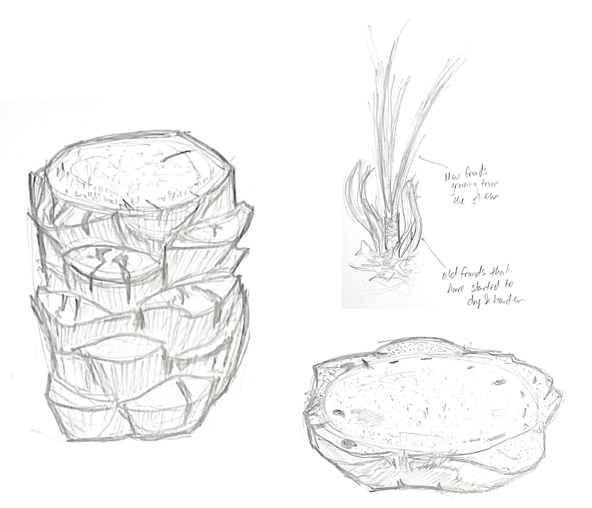
    <small class="nk-caption">Drawings and studies of the Date Palm.</small>
  

  

    <h2>It begins with Al Nakhla, the Date Palm Tree.</h2>
    
The Nakhla (نخلة), or date palm tree, is indigenous to the Arabian peninsula and an important cultural symbol of the United Arab Emirates. Found primarily in oases, the tree provides many versatile uses. Firstly, it gives nourishment and food through its date fruit, secondly, parts such as its fronds and leaves are used as materials for traditional construction and crafts, and lastly, its shade calls for people to gather and rest underneath it. One of the rare flora able to thrive in the desert, it was dubbed the “tree of life” by the late Sheikh Zayed bin Sultan Al Nahyan, the founding father of the country.

    
The Nakhla Stool reinterprets the date palm tree, a cultural symbol of the UAE, as a functional furniture piece that bridges tradition and modernity. Its form is inspired by the palm trunk's texture and geometric patterns derived from girih and traditional Arabic motifs. Designed for residential or communal indoor spaces, the stool fosters intimate gatherings, reflecting the palm’s historical role as a centerpiece of hospitality in Emirati homes. Its compact size and ergonomic curvature make it adaptable to living rooms, majlis settings, or cultural institutions, blending storytelling with everyday utility.

  

  <h2>It’s not just a stool... It’s a statement.</h2>
  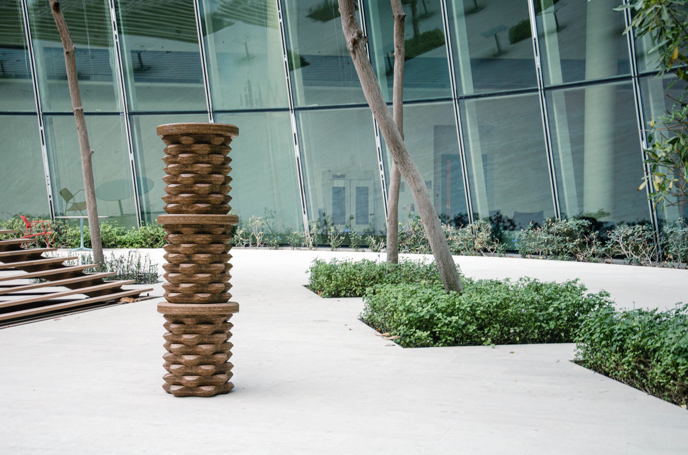
  
Shaped similar to the tree’s trunk, the design of the stool references both the date palm’s texture and the repetition motifs of islamic geometric art commonly found in Arabic architecture and textiles.

  <h2>It’s not just a stool... It’s a system.</h2>
  
The Nakhla Stool takes inspiration from the Emirati cultural icon to activate social spaces. Each set comes with three stools that are a larger part of a whole. In the same way as the date palm tree, it encourages people to gather by activating social spaces. The system stacks units vertically for different functions.

  

    

      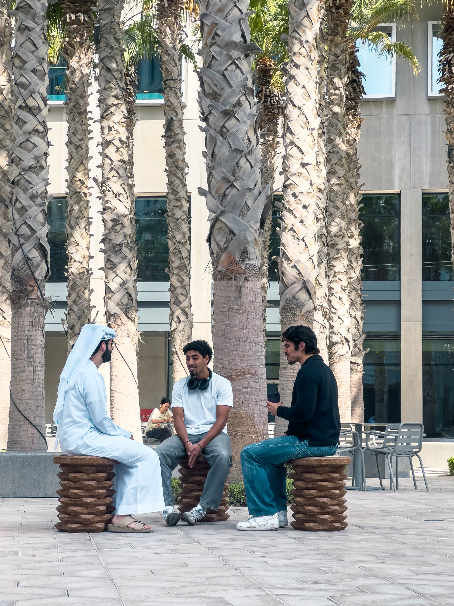
      <h3>Sitting Stool</h3>
      
The stool's ergonomic height makes it an inviting piece of furniture to sit on, encouraging togetherness in living rooms, majlis', and public institutions.

      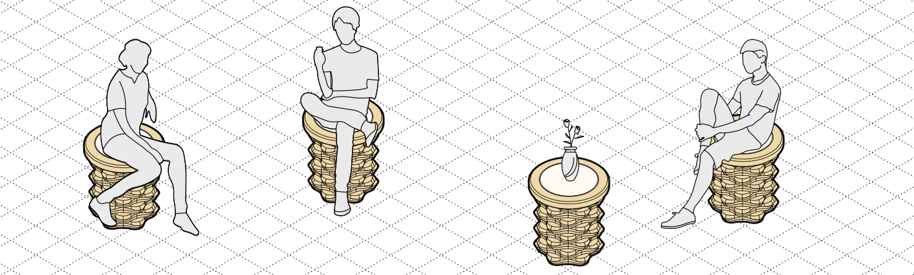
    

    

      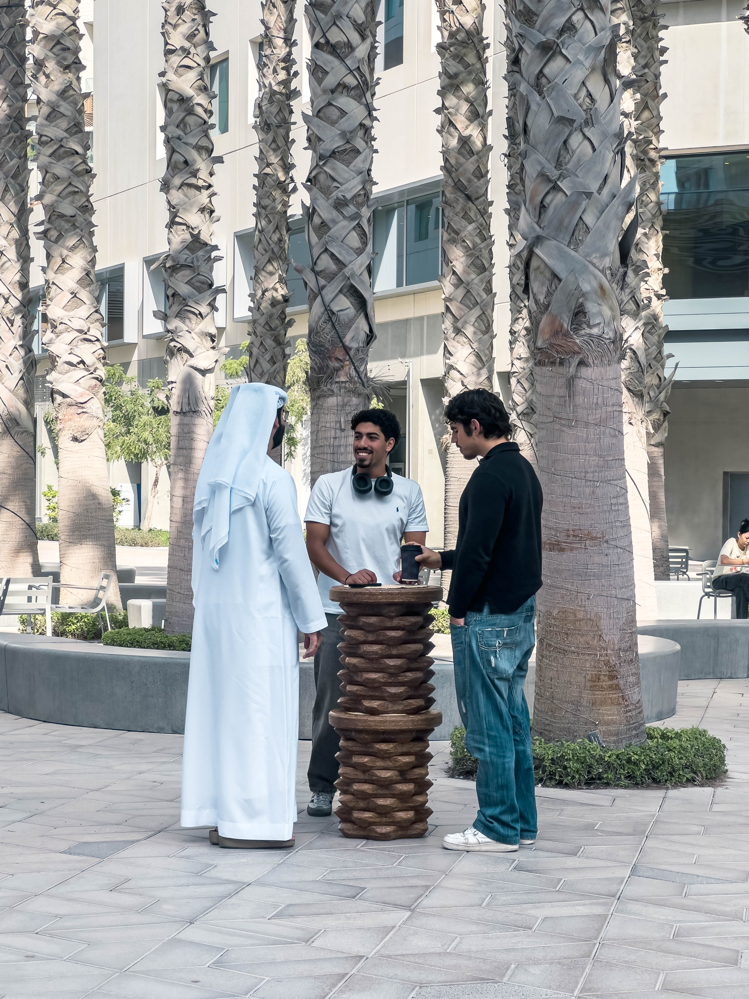
      <h3>Standing Table</h3>
      
Stacking two stools on top of each other allows it to be a standing desk or cocktail table, making it suited for events.

      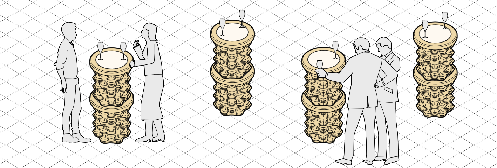
    

    

      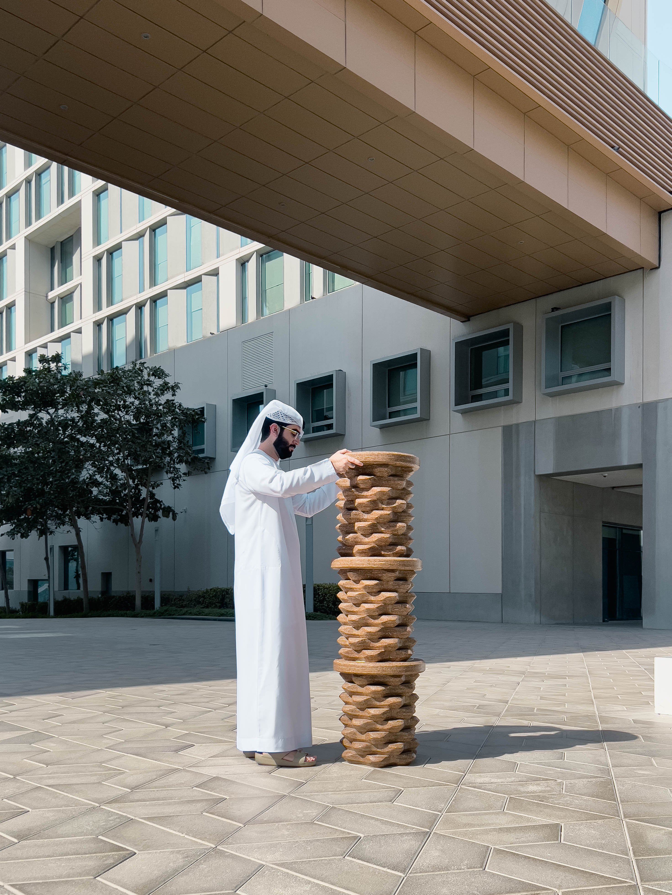
      <h3>Sculptural Piece</h3>
      
When three are stored vertically, the Nakhla Stool turns into a sculptural piece that alludes to the date palm trunk, a striking centerpoint.

      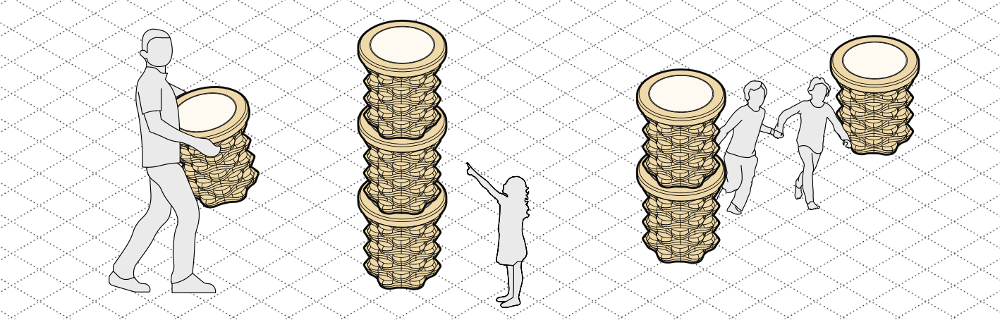
    

  

  <h2>Fully of the Date Palm.</h2>
  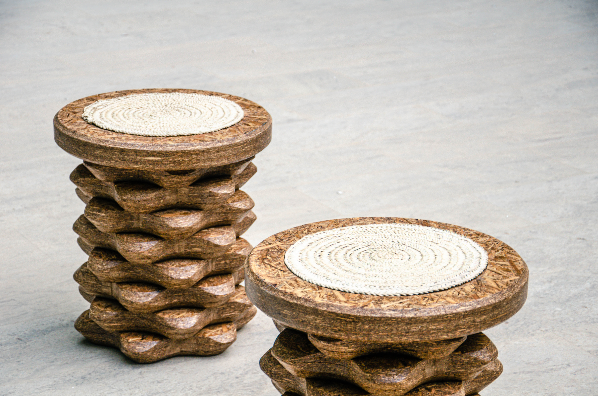
  

    
The Nakhla Stool is simple in its materiality, being made fully out of palm derived materials. Its top is made out of Khoos, a traditional sarood mat woven out of dried palm leaves. This iteration was handcrafted by artisan Mariam Al Dhaheri. The rest of the stool is made out of DesertBoard, An engineered wood board made out of waste palm fronds, locally sourced and produced in the UAE. Through this, the Date Palm receives second life as a social furniture piece.

    

      <figure>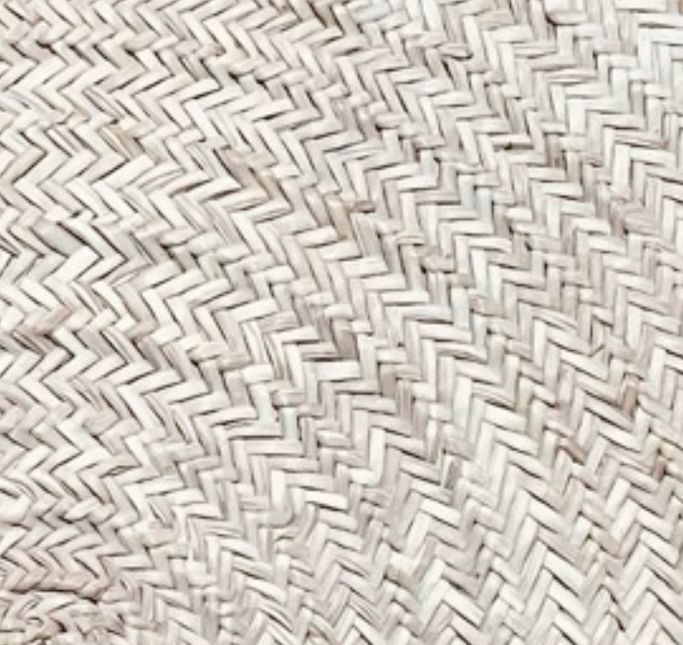<figcaption>Khoos</figcaption></figure>
      <figure>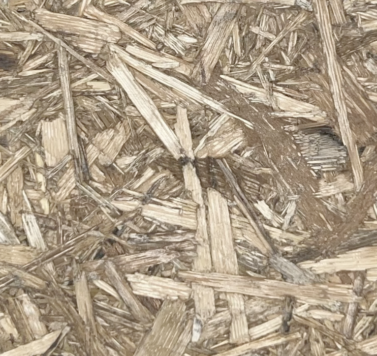<figcaption>DesertBoard</figcaption></figure>
    

  

  <a href="/assets/images/projects/nakhla-stool/Nakhla_Stool-5.jpg" class="glightbox" data-gallery="nakhla">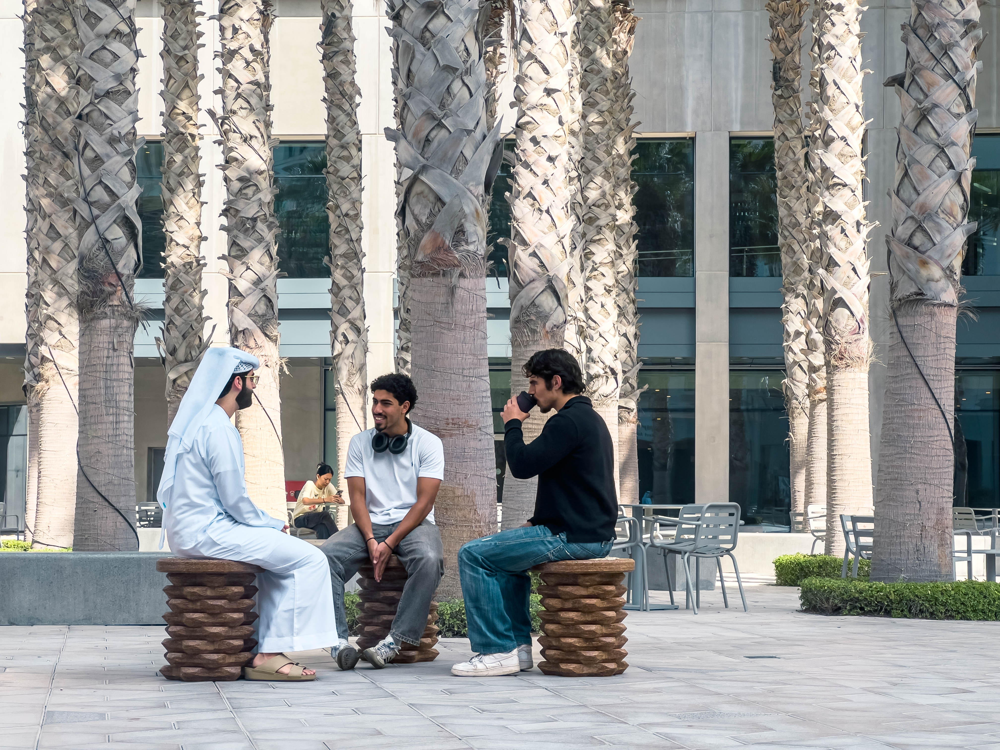</a>
  <a href="/assets/images/projects/nakhla-stool/Nakhla_Stool-17-1.jpg" class="glightbox" data-gallery="nakhla">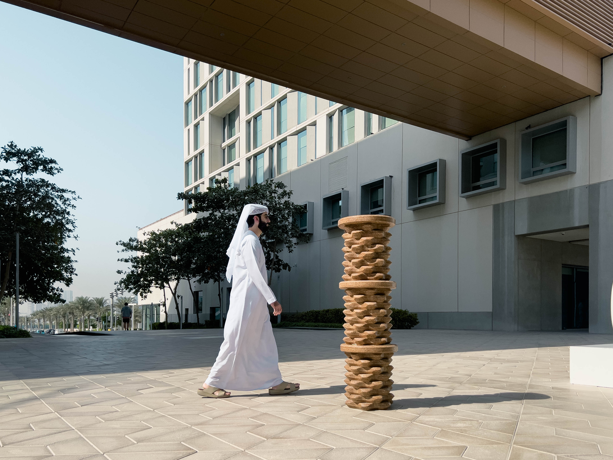</a>
  <a href="/assets/images/projects/nakhla-stool/Nakhla_Stool-35.jpg" class="glightbox" data-gallery="nakhla">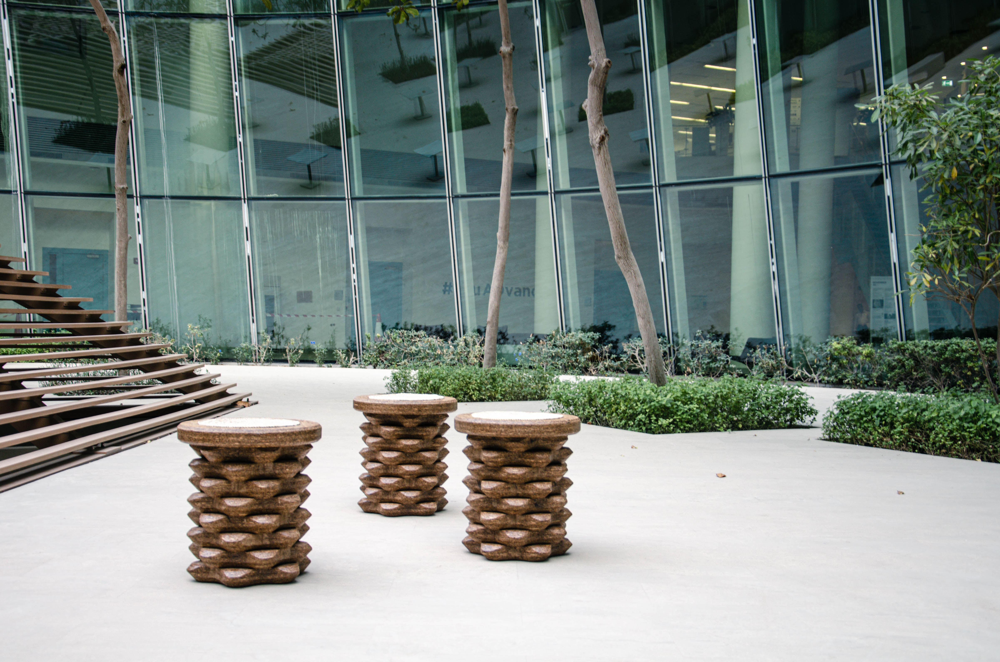</a>
  <a href="/assets/images/projects/nakhla-stool/Nakhla_Stool-11.jpg" class="glightbox" data-gallery="nakhla">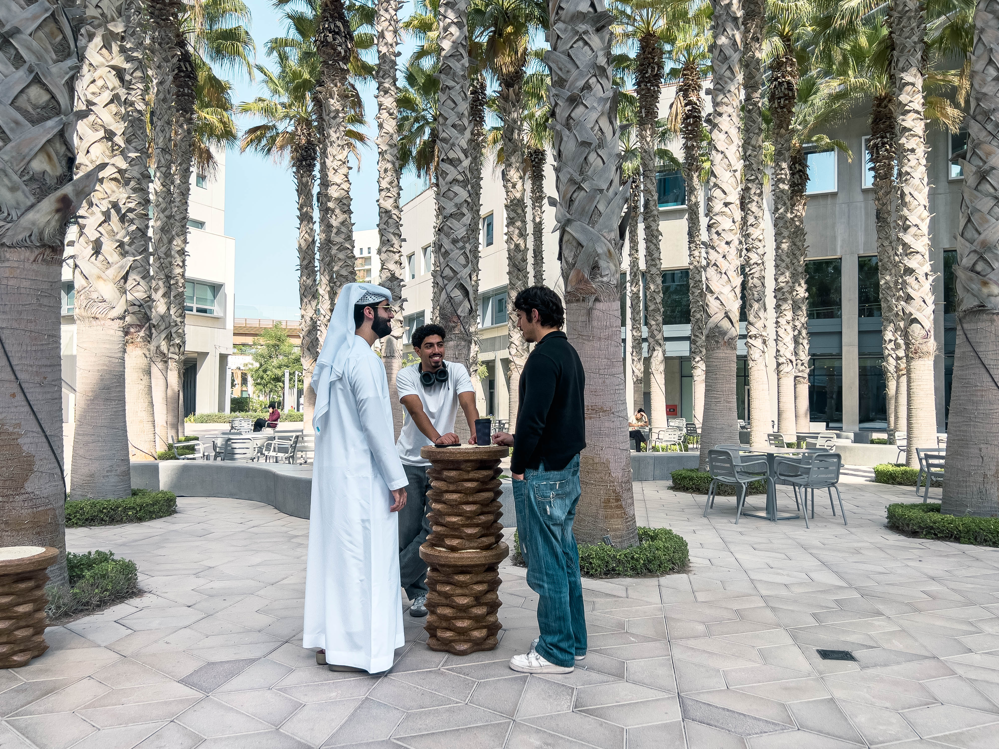</a>
  <a href="/assets/images/projects/nakhla-stool/Nakhla_Stool-44.jpg" class="glightbox" data-gallery="nakhla">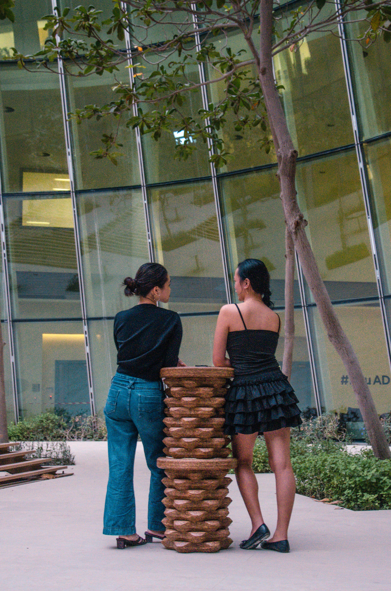</a>
  <a href="/assets/images/projects/nakhla-stool/Nakhla_Stool-42.jpg" class="glightbox" data-gallery="nakhla">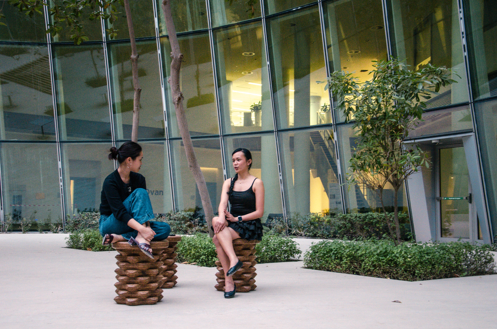</a>

